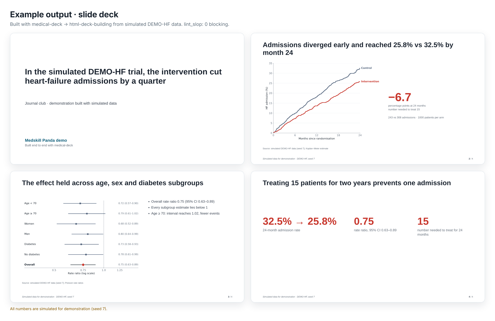
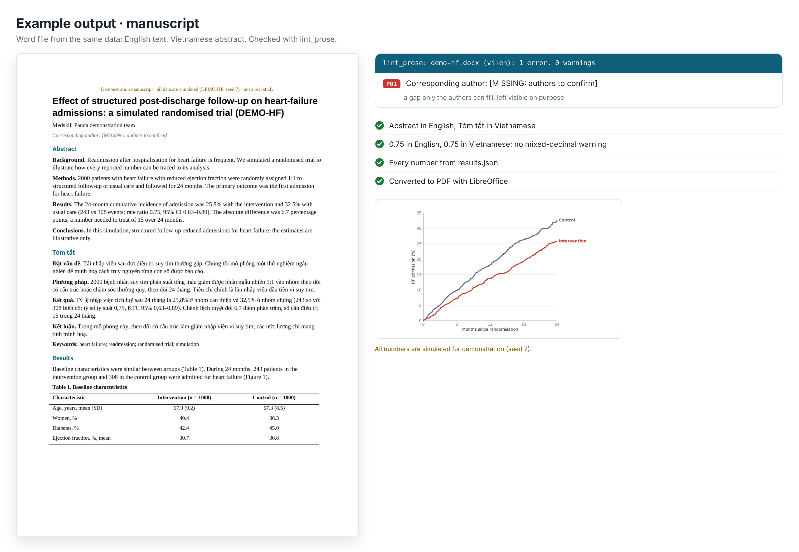

<div align="center">


**English** · [Tiếng Việt](README.vi.md)

# Medskill Panda

**Evidence-checked medical slides and scientific writing, done by your own coding agent.**<br>
A Claude Code plugin that interviews you, plans the talk, checks every number against its
source, catches the tells of machine-made slides, and helps you write papers, reviews,
protocols and posters in English, Vietnamese or both.

[](LICENSE)
[](#install)
[](CHANGELOG.md)
[](#skills)
[](https://github.com/jackfeng94/medskill-panda/actions/workflows/tests.yml)
[](#hooks)



<sub>A real deck built by the plugin from simulated data (<a href="examples/demo-hf/">examples/demo-hf</a>): assertion titles, figures drawn from the data, a source line on every slide, 0 slop findings.</sub>

</div>

---

## Why

- **No number from memory.** Every hazard ratio, percentage and confidence interval on a
  slide has a source, a locator (page, table, figure) and a verbatim quote. PMIDs, DOIs and
  NCT numbers come only from real lookups.
- **Nothing is built before you approve the plan.** A hook keeps `build/` and `out/` closed
  until you say yes to `plan.md`.
- **No "AI slides".** Eyebrow labels, "click for next" cues on the slide, "recoloured"
  notes and placeholders are caught as soon as the file is saved.
- **Local and international.** Interviews, slides and manuscripts in English, Vietnamese
  or both; Vietnamese number format (`0,58`), Vietnamese Ministry of Health guidance and
  national drug formulary; your own hospital or congress template.

## How it works

<div align="center">

</div>

Slides and manuscripts share one evidence spine: the same brief, the same approved plan and
the same evidence ledger, then a slides line and a writing line that meet again at the audit.
For a talk, just say *"make a journal club deck on DAPA-HF"*; `medical-deck` runs these
stages:

| # | Stage | Skill | Your part |
|---|-------|-------|-----------|
| 1 | Interview | `deck-grilling` | Answer one round of questions, confirm `brief.md` |
| 2 | Template | `template-matching` | Supply your .pptx/.potx template (optional) |
| 3 | Plan | `deck-planning` | **Approve `plan.md`** |
| 4 | Evidence | `evidence-research` | — |
| 5 | Figures | `medical-figures` | — |
| 6 | Build | `html-deck-building` · `pptx-deck-building` · `beamer-deck-building` | — |
| 7 | Audit | `slop-audit` + `evidence-audit` | — |
| 8 | Deliver | — | Get the file and a report of what was and was not verified |

**Three output formats:** HTML (one offline file with motion and a laser pointer),
PowerPoint (inside your template, with native editable charts) and LaTeX Beamer (PDF, for
defences and equation-heavy talks).

## Install

In Claude Code:

```bash
claude plugin marketplace add jackfeng94/medskill-panda
```

```bash
claude plugin install medskill-panda@medskill-panda
```

Or, inside a Claude Code session: `/plugin marketplace add jackfeng94/medskill-panda`, then
`/plugin install medskill-panda@medskill-panda`.

Update to the latest version:

```bash
claude plugin marketplace update medskill-panda
```

Try it from a clone:

```bash
git clone https://github.com/jackfeng94/medskill-panda.git
```

```bash
claude --plugin-dir ./medskill-panda
```

## Quick start

| You want to | Type |
|-------------|------|
| Make a talk | *"Make a 20-minute grand rounds deck on HFrEF"* |
| Only settle what the talk is about | `/medskill-panda:grill-deck` |
| Check an existing deck | `/medskill-panda:audit-deck` |
| See where each talk stands | `/medskill-panda:status` |
| Set up a writing project | `/medskill-panda:scientific-writer-init` |
| Write a paper for an international journal | *"Draft a STROBE cohort paper for [journal]"* |
| Write in Vietnamese with a bilingual abstract | *"Viết bài báo gốc về [đề tài], tóm tắt song ngữ"* |
| Check a Word, LaTeX or Markdown manuscript | `/medskill-panda:audit-manuscript paper.docx` |

## Scientific writing

Run `/medskill-panda:scientific-writer-init` once in your project folder. From then on, each
writing request follows the same principles as the slides:

1. **A short interview**: document type, venue, **language (English, Vietnamese or
   bilingual)**, file format (Word, LaTeX, Markdown), study design and reporting guideline.
2. **You approve the outline** before any drafting.
3. **Evidence**: free searches of PubMed, Europe PMC, OpenAlex and Crossref; each claim is
   tied to a source and a quote. Unpublished text never leaves your machine without your
   permission.
4. **Section-by-section drafting**, with numbers only from your data or from sources that
   were opened.
5. **Audit** with `/medskill-panda:audit-manuscript`: machine-made phrasing in English and
   Vietnamese, statistics without citations, placeholders, `p = 0.000`, mixed decimal
   separators, numbers that differ between the two language versions, claim–evidence
   links, reporting guideline and authorship.

<div align="center">

</div>

## Skills

<details open>
<summary><b>Presentations (13)</b> — one entry point: <code>medical-deck</code></summary>

| Skill | Role |
|-------|------|
| `medical-deck` | Runs the eight stages; the starting point for every slide request |
| `deck-grilling` | Interview that settles the brief: audience, duration, format, template, sources |
| `deck-planning` | Assertion-title outline, a visual for each slide, time budget |
| `evidence-research` | PubMed, Europe PMC, ClinicalTrials.gov, Vietnamese guidance; numbers quoted verbatim |
| `medical-figures` | Kaplan–Meier, forest plots, CONSORT/PRISMA, mechanisms, motion graphics |
| `template-matching` | Measures colours, fonts and layouts from a hospital or congress template |
| `html-deck-building` | Single-file HTML deck with motion and presenter tools |
| `pptx-deck-building` | PowerPoint in your template, native charts, speaker notes |
| `beamer-deck-building` | LaTeX Beamer → PDF; conference, seminar and defence templates |
| `slop-audit` | Catches the tells of machine-made slides |
| `evidence-audit` | Numbers against sources, references, patient-identifier scan |
| `grill-deck` | Shortcut: run only the interview |
| `audit-deck` | Shortcut: run both audits on an existing deck |

</details>

<details>
<summary><b>Writing & research (11)</b></summary>

`scientific-writing` · `literature-review` · `research-lookup` · `citation-management` ·
`peer-review` · `scientific-critical-thinking` · `scholar-evaluation` ·
`hypothesis-generation` · `research-grants` · `venue-templates` · `market-research-reports`

</details>

<details>
<summary><b>Clinical (3)</b> — research or de-identified data only</summary>

`clinical-reports` · `clinical-decision-support` · `treatment-plans`

Every output needs review by a qualified professional; not for treatment decisions.

</details>

<details>
<summary><b>Figures & posters (5)</b></summary>

`scientific-schematics` · `infographics` · `generate-image` · `latex-posters` · `pptx-posters`

</details>

<details>
<summary><b>Files & web (6)</b></summary>

`docx` · `pdf` · `pptx` · `xlsx` · `markitdown` · `parallel-web`

</details>

## Hooks

Active only during slide work, silent everywhere else:

| Hook | What it does |
|------|--------------|
| `route_prompt.py` | Prompts that mention "slides", "presentation", "journal club"… are reminded to start from `medical-deck` |
| `plan_gate.py` | Blocks writes to `build/`, `out/` and deck-builder commands until `plan.md` is approved |
| `slop_on_save.py` | Lints every saved HTML slide and reports blocking findings at once |

Needs Python 3.8+. Without Python the hooks do nothing, and they never block your work
because of an error of their own. Turn the plan gate off with `MEDSKILL_PANDA_NO_GATE=1`.

## API keys (optional)

| Variable | Used by |
|----------|---------|
| `OPENROUTER_API_KEY` | `generate-image`, `scientific-schematics`, `infographics` |
| `PARALLEL_API_KEY` | `parallel-web`, `research-lookup` |

Everything else, including the whole slide workflow and PubMed search, needs no key.

## Development

```bash
python -m unittest discover -s tests -v
```

The tests use the standard library; install `pypdf python-pptx python-docx reportlab requests`
to run the PDF, PPTX and DOCX tests and the lookup scripts too. CI runs on every push.
Changes between versions are in [`CHANGELOG.md`](CHANGELOG.md).

## Licence

MIT, © Nguyen-Minh-Tan Phung ([@jackfeng94](https://github.com/jackfeng94)). Third-party
components and their licences: see [`NOTICE.md`](NOTICE.md).
