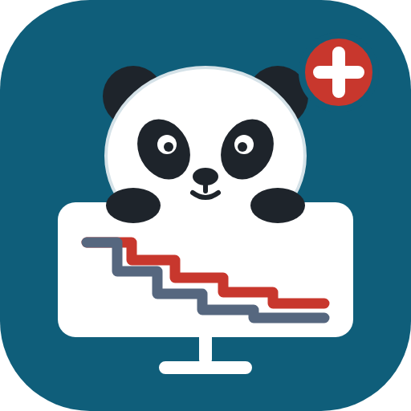
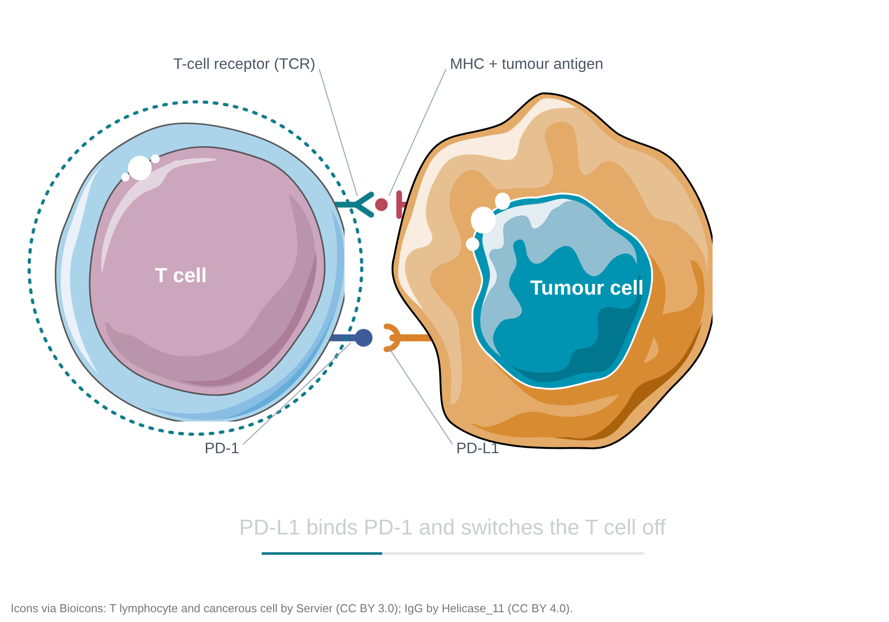
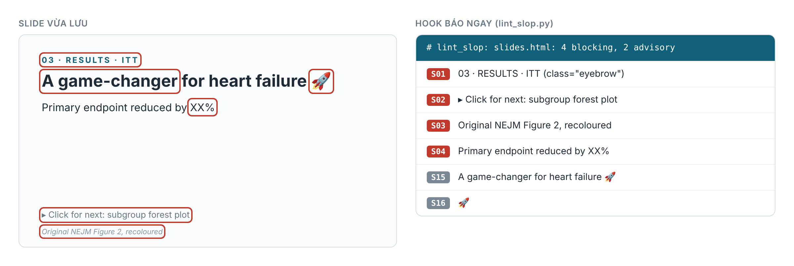
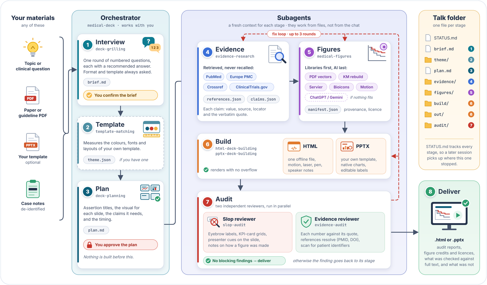

<div align="center">



# Medskill Panda

**Slide y khoa có kiểm chứng và viết khoa học, do chính agent lập trình của bạn thực hiện.**<br>
Một plugin cho Claude Code: phỏng vấn bạn, lập kế hoạch bài nói, đối chiếu mọi con số với nguồn,
bắt các dấu hiệu "slide do máy làm", và hỗ trợ viết bài báo, tổng quan, đề cương, poster.

[](LICENSE)
[](#cài-đặt)
[](CHANGELOG.md)
[](#các-skill)
[](https://github.com/jackfeng94/medskill-panda/actions/workflows/tests.yml)
[](#hook)




<sub>Trái: hình động cơ chế PD-1/PD-L1 dựng bằng <code>medical-figures</code>, có ghi công giấy phép. Phải: hook báo lỗi "AI slop" ngay khi slide được lưu.</sub>

</div>

---

## Vì sao dùng

- **Không con số nào từ trí nhớ.** Mọi HR, %, khoảng tin cậy trên slide đều có nguồn, vị trí
  trong bài (trang, bảng, hình) và câu trích nguyên văn. PMID, DOI, NCT chỉ lấy từ tra cứu thật.
- **Không dựng slide trước khi bạn duyệt kế hoạch.** Hook khoá thư mục `build/` và `out/`
  cho đến khi `plan.md` được bạn đồng ý.
- **Không "slide AI".** Nhãn eyebrow, gợi ý "bấm tiếp" trên slide, ghi chú "đã đổi màu",
  placeholder… bị phát hiện ngay lúc lưu.
- **Hợp với Việt Nam.** Phỏng vấn và slide bằng tiếng Việt, định dạng số `0,58`, tra cứu
  phác đồ Bộ Y tế và Dược thư Quốc gia, dùng template bệnh viện của bạn.

## Cách hoạt động

<div align="center">

</div>

Chỉ cần nói *"làm slide journal club về DAPA-HF"*. `medical-deck` điều phối 8 bước; mỗi bước
lưu thành file trong thư mục bài nói, nên phiên sau có thể làm tiếp đúng chỗ đang dừng.

| # | Bước | Skill | Bạn cần làm |
|---|------|-------|-------------|
| 1 | Phỏng vấn | `deck-grilling` | Trả lời một lượt câu hỏi, xác nhận `brief.md` |
| 2 | Template | `template-matching` | Đưa file .pptx/.potx của bệnh viện (nếu có) |
| 3 | Kế hoạch | `deck-planning` | **Duyệt `plan.md`** |
| 4 | Bằng chứng | `evidence-research` | — |
| 5 | Hình | `medical-figures` | — |
| 6 | Dựng slide | `html-deck-building` · `pptx-deck-building` · `beamer-deck-building` | — |
| 7 | Kiểm tra | `slop-audit` + `evidence-audit` | — |
| 8 | Bàn giao | — | Nhận file và báo cáo những gì đã/chưa kiểm chứng |

**Ba định dạng xuất:** HTML (một file offline, có chuyển động, bút laser), PowerPoint
(trong template của bạn, biểu đồ gốc sửa được), LaTeX Beamer (PDF, hợp với bảo vệ luận án
và bài có công thức).

## Cài đặt

Trong Claude Code:

```bash
claude plugin marketplace add jackfeng94/medskill-panda
```

```bash
claude plugin install medskill-panda@medskill-panda
```

Hoặc gõ trong phiên Claude Code: `/plugin marketplace add jackfeng94/medskill-panda` rồi
`/plugin install medskill-panda@medskill-panda`.

Cập nhật bản mới:

```bash
claude plugin marketplace update medskill-panda
```

Chạy thử từ bản clone:

```bash
git clone https://github.com/jackfeng94/medskill-panda.git
```

```bash
claude --plugin-dir ./medskill-panda
```

## Bắt đầu nhanh

| Bạn muốn | Gõ |
|----------|----|
| Làm bài thuyết trình | *"Làm slide grand rounds 20 phút về suy tim EF giảm"* |
| Chỉ chốt ý tưởng bài nói | `/medskill-panda:grill-deck` |
| Kiểm tra slide có sẵn | `/medskill-panda:audit-deck` |
| Xem tiến độ các bài nói | `/medskill-panda:status` |
| Thiết lập dự án viết bài báo | `/medskill-panda:scientific-writer-init` |
| Viết bài báo bằng tiếng Anh cho tạp chí quốc tế | *"Draft a STROBE cohort paper for [journal]"* |
| Viết tổng quan tài liệu | *"Viết tổng quan hệ thống về SGLT2i trong suy thận mạn"* |
| Kiểm tra bản thảo Word/LaTeX/Markdown | `/medskill-panda:audit-manuscript bai-bao.docx` |

## Viết khoa học

Chạy `/medskill-panda:scientific-writer-init` một lần trong thư mục dự án. Từ đó, mỗi yêu
cầu viết đi theo cùng nguyên tắc như làm slide:

1. **Phỏng vấn ngắn**: loại bài, nơi công bố, **ngôn ngữ (tiếng Việt, tiếng Anh hay song
   ngữ)**, định dạng (Word, LaTeX, Markdown), thiết kế nghiên cứu và guideline báo cáo.
2. **Bạn duyệt dàn ý** trước khi viết.
3. **Bằng chứng**: tra PubMed, Europe PMC, OpenAlex, Crossref miễn phí; mỗi nhận định gắn
   với nguồn và câu trích. Bản thảo chưa công bố không gửi ra ngoài.
4. **Viết từng phần**, số liệu chỉ từ dữ liệu của bạn hoặc từ nguồn đã mở.
5. **Kiểm tra** bằng `/medskill-panda:audit-manuscript`: văn phong "AI" bằng cả tiếng Việt
   và tiếng Anh, con số thiếu trích dẫn, placeholder, `p = 0.000`, dấu thập phân lẫn lộn,
   số liệu lệch giữa bản tiếng Việt và tiếng Anh, liên kết nhận định–bằng chứng, guideline,
   tác giả.

## Các skill

<details open>
<summary><b>Thuyết trình (13)</b> — một điểm vào duy nhất: <code>medical-deck</code></summary>

| Skill | Vai trò |
|-------|---------|
| `medical-deck` | Điều phối 8 bước; điểm bắt đầu cho mọi yêu cầu làm slide |
| `deck-grilling` | Phỏng vấn để chốt brief: đối tượng, thời lượng, định dạng, template, nguồn |
| `deck-planning` | Dàn ý tiêu đề-khẳng định, hình cho từng slide, ngân sách thời gian |
| `evidence-research` | PubMed, Europe PMC, ClinicalTrials.gov, phác đồ Bộ Y tế; trích số nguyên văn |
| `medical-figures` | Kaplan–Meier, forest plot, CONSORT/PRISMA, hình cơ chế, hình động |
| `template-matching` | Đo màu, font, bố cục từ template bệnh viện/hội nghị |
| `html-deck-building` | Bộ slide HTML một file, chuyển động, công cụ trình chiếu |
| `pptx-deck-building` | PowerPoint trong template, biểu đồ gốc, ghi chú người nói |
| `beamer-deck-building` | LaTeX Beamer → PDF, template hội nghị / seminar / bảo vệ |
| `slop-audit` | Bắt dấu hiệu slide do máy làm |
| `evidence-audit` | Đối chiếu số với nguồn, kiểm tra trích dẫn, quét thông tin định danh bệnh nhân |
| `grill-deck` | Lệnh tắt: chỉ chạy phỏng vấn |
| `audit-deck` | Lệnh tắt: chạy cả hai bước kiểm tra trên slide có sẵn |

</details>

<details>
<summary><b>Viết & nghiên cứu (11)</b></summary>

`scientific-writing` · `literature-review` · `research-lookup` · `citation-management` ·
`peer-review` · `scientific-critical-thinking` · `scholar-evaluation` ·
`hypothesis-generation` · `research-grants` · `venue-templates` · `market-research-reports`

</details>

<details>
<summary><b>Lâm sàng (3)</b> — chỉ dùng với dữ liệu nghiên cứu/đã khử định danh</summary>

`clinical-reports` · `clinical-decision-support` · `treatment-plans`

Mọi đầu ra cần người có chuyên môn duyệt; không dùng để ra quyết định điều trị.

</details>

<details>
<summary><b>Hình ảnh & poster (5)</b></summary>

`scientific-schematics` · `infographics` · `generate-image` · `latex-posters` · `pptx-posters`

</details>

<details>
<summary><b>Tệp & web (6)</b></summary>

`docx` · `pdf` · `pptx` · `xlsx` · `markitdown` · `parallel-web`

</details>

## Hook

Chỉ hoạt động khi làm slide, im lặng ở mọi việc khác:

| Hook | Làm gì |
|------|--------|
| `route_prompt.py` | Yêu cầu có chữ "slide", "thuyết trình", "journal club"… → nhắc bắt đầu từ `medical-deck` |
| `plan_gate.py` | Chặn ghi vào `build/`, `out/` và lệnh dựng slide cho đến khi `plan.md` được duyệt |
| `slop_on_save.py` | Quét AI slop mỗi lần lưu slide HTML, báo lỗi chặn ngay |

Cần Python 3.8+; không có Python thì hook tự bỏ qua, không bao giờ chặn công việc vì lỗi
của chính nó. Tắt cổng duyệt: `MEDSKILL_PANDA_NO_GATE=1`.

## Khoá API (tuỳ chọn)

| Biến | Dùng cho |
|------|----------|
| `OPENROUTER_API_KEY` | `generate-image`, `scientific-schematics`, `infographics` |
| `PARALLEL_API_KEY` | `parallel-web`, `research-lookup` |

Các skill còn lại, kể cả toàn bộ quy trình làm slide và tra cứu PubMed, không cần khoá.

## Phát triển

```bash
python -m unittest discover -s tests -v
```

Test dùng thư viện chuẩn; cài thêm `pypdf python-pptx reportlab` để chạy cả test PDF/PPTX.
CI chạy trên mỗi lần push. Thay đổi giữa các phiên bản ở [`CHANGELOG.md`](CHANGELOG.md).

## Giấy phép

MIT, © Nguyen-Minh-Tan Phung ([@jackfeng94](https://github.com/jackfeng94)). Các thành phần
bên thứ ba và giấy phép của chúng: xem [`NOTICE.md`](NOTICE.md).
