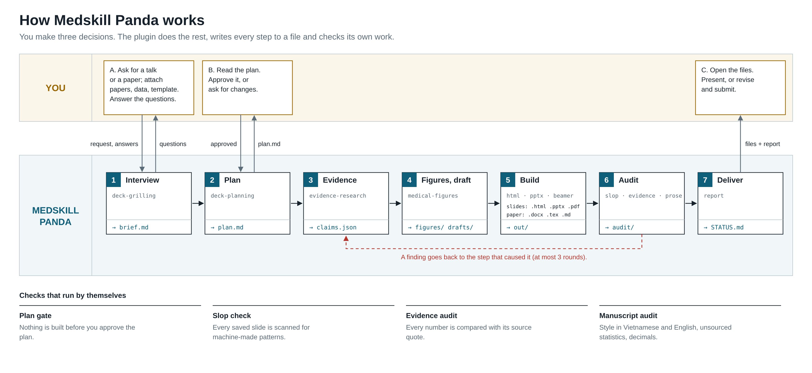

# Medskill Panda from A to Z

**English** · [Tiếng Việt](HUONG-DAN.md)

This guide is for people who have **never used a terminal or Claude Code**. Follow it from
top to bottom; each step says how to check that it worked. The first run takes 20–30 minutes.

**Contents**

1. [What Medskill Panda does](#1-what-medskill-panda-does)
2. [What you need](#2-what-you-need)
3. [Open a terminal](#3-open-a-terminal)
4. [Install Claude Code](#4-install-claude-code)
5. [Create a working folder and sign in](#5-create-a-working-folder-and-sign-in)
6. [Install the Medskill Panda plugin](#6-install-the-medskill-panda-plugin)
7. [Make your first talk](#7-make-your-first-talk)
8. [Check an existing deck](#8-check-an-existing-deck)
9. [Write a paper, thesis or protocol](#9-write-a-paper-thesis-or-protocol)
10. [Carry on the next day](#10-carry-on-the-next-day)
11. [Update the plugin](#11-update-the-plugin)
12. [Troubleshooting](#12-troubleshooting)
13. [Data and responsibility](#13-data-and-responsibility)
14. [Glossary](#14-glossary)

---

## 1. What Medskill Panda does

Medskill Panda is a **plugin** for **Claude Code**, an AI assistant that runs on your
computer. Once installed, you type a request in plain English or Vietnamese, for example
*"Make a 15-minute journal club deck on the DAPA-HF trial"*, and the plugin:

1. asks you one round of questions (audience, duration, language, format…);
2. plans every slide and **waits for your approval**;
3. searches PubMed, ClinicalTrials.gov and others, and records the source and quote for every number;
4. draws charts from data and builds HTML, PowerPoint or PDF slides;
5. checks its own work: numbers against sources, machine-made patterns, patient identifiers;
6. delivers the files with a report of what was and was not verified.

Papers, theses and protocols follow the same steps, producing Word, LaTeX or Markdown in
English, Vietnamese or both.



## 2. What you need

| You need | Notes |
|----------|-------|
| A Mac, a Windows 10/11 PC or Linux | With an internet connection |
| A **paid** Claude plan (Pro, Max, Team or Enterprise) or a Claude Console account | Claude Code does not run on the free plan |
| Python 3.8 or newer | For the automatic checks. Usually present on macOS and Linux; on Windows install it from python.org and **tick "Add python.exe to PATH"** |
| PowerPoint, Word or LibreOffice | Only to open the `.pptx` and `.docx` results |

You do not need to program. You only paste the commands shown here.

## 3. Open a terminal

A terminal is a window where you type commands.

- **macOS:** press `Cmd + Space`, type `Terminal`, press Enter.
- **Windows:** press the Windows key, type `PowerShell`, choose **Windows PowerShell**.
- **Linux:** press `Ctrl + Alt + T`.

Whenever this guide shows a command box, **copy the whole box**, paste it into the terminal
and press Enter. On Windows, paste with a right-click or `Ctrl + V`.

## 4. Install Claude Code

Pick **one** command for your computer.

**macOS or Linux:**

```bash
curl -fsSL https://claude.ai/install.sh | bash
```

**Windows, in PowerShell:**

```powershell
irm https://claude.ai/install.ps1 | iex
```

**Windows, if you use Command Prompt (CMD) instead of PowerShell:**

```bat
curl -fsSL https://claude.ai/install.cmd -o install.cmd && install.cmd && del install.cmd
```

**Check:** close the terminal, open it again and type:

```bash
claude --version
```

A version number means it worked. If you see *"claude is not recognized"* or *"command not
found"*, see [Troubleshooting](#12-troubleshooting).

> The install commands come from the official Claude Code documentation,
> [code.claude.com/docs/en/setup](https://code.claude.com/docs/en/setup). If they fail,
> check that page in case they have changed.

## 5. Create a working folder and sign in

Give every talk or paper its own folder. Create one called `talks` in Documents:

**macOS or Linux:**

```bash
mkdir -p ~/Documents/talks && cd ~/Documents/talks
```

**Windows (PowerShell):**

```powershell
mkdir $HOME\Documents\talks; cd $HOME\Documents\talks
```

Start Claude Code in that folder:

```bash
claude
```

The first time, Claude Code opens your browser so you can **sign in** to Claude. When you are
back in the terminal and see the `>` prompt, it is ready.

## 6. Install the Medskill Panda plugin

At the Claude Code prompt (not the plain terminal), type these two commands, pressing Enter
after each:

```text
/plugin marketplace add jackfeng94/medskill-panda
```

```text
/plugin install medskill-panda@medskill-panda
```

Follow any prompts. Then **quit Claude Code** (type `/exit` or press `Ctrl + C` twice) and run
`claude` again so the plugin loads.

**Check:** type `/plugin` and look for `medskill-panda` among the installed plugins, or type
`/medskill-panda:status`; a reply saying there are no talks yet means the plugin is working.

## 7. Make your first talk

### 7.1. Gather your material (optional)

If you have paper PDFs, guidelines or your hospital's PowerPoint template, copy them into the
`talks` folder first. The plugin uses them as the main sources and searches for the rest.

### 7.2. Type your request

At the Claude Code prompt, just ask. For example:

```text
Make a 15-minute journal club deck on the DAPA-HF paper in dapa-hf.pdf, for residents
```

### 7.3. Answer the questions

The first reply **only asks; nothing is built yet**. You get 6–8 numbered questions, each
with a recommended answer. Short answers are fine:

```text
1 agree; 2 15 min + 5 min Q&A; 3 English; 4 PowerPoint; 5 use template hospital.pptx;
6 presenter: Dr Jane Doe, Cardiology
```

The plugin summarises this in `brief.md` and asks you to confirm. Reply *"Yes"* or correct it.

### 7.4. Approve the plan

The plugin writes `plan.md`: each slide's title (a full-sentence conclusion), its figure, the
numbers it needs, and its timing. Read it, then:

- to accept: type *"Approve the plan"*;
- to change it: say what, e.g. *"Merge slides 4 and 5 and add a slide on adverse events"*.

**Nothing is built before you approve.** This is deliberate: an automatic guard (a *hook*)
blocks writing to the `build/` and `out/` folders until the plan is approved.

### 7.5. Let it work

The plugin searches, draws figures, builds the slides and audits them. This takes from a few
minutes to half an hour depending on length; progress is shown on screen. If Claude Code asks
permission to run a command or write a file, read it and choose **Yes**.

### 7.6. Open the results

Everything is in a sub-folder named after the talk, e.g. `talks/dapa-hf/`:

| File | What it is |
|------|------------|
| `out/<name>.html` | The HTML deck. Open it in Chrome, Edge, Safari or Firefox |
| `out/<name>.pptx` | The PowerPoint deck (if you chose PowerPoint). All text, diagrams and charts are editable |
| `audit/` | Audit reports: numbers, sources, machine-made patterns |
| `brief.md`, `plan.md` | The talk's details and the plan you approved |
| `evidence/` | The source, quote and location of every number |
| `STATUS.md` | Progress of every step |

Open the folder from the terminal: macOS `open .`, Windows `explorer .`.

**Presenting the HTML deck:**

| Key | Does |
|-----|------|
| `→`, `Space`, `Enter` | Next slide / next step |
| `←` | Previous slide |
| `F` | Full screen |
| `N` | Speaker notes |
| `L` | Laser pointer |
| `P` | Pen; `C` circle; `Z` undo; `E` erase this slide's ink |
| `Esc` | Back to the normal pointer |
| `1`–`9` | Jump to that slide |

### 7.7. Change things afterwards

Just say it: *"Slide 6 has too much text, cut it to three points"*, *"Turn the bar chart into a
forest plot"*, *"Add a references slide"*. The plugin redoes only the affected step and checks
again.

## 8. Check an existing deck

Copy the `.pptx` or `.html` file into your working folder and type:

```text
/medskill-panda:audit-deck
```

The plugin asks for the file and the source papers (if you have them), then reports numbers
that are wrong or unsourced, references that do not resolve, patient identifiers and
machine-made patterns, blocking problems first.

## 9. Write a paper, thesis or protocol

### 9.1. Set up a writing project (once per folder)

Create a new folder, e.g. `paper`, run `claude` in it and type:

```text
/medskill-panda:scientific-writer-init
```

This creates `CLAUDE.md` and `AGENTS.md`, the instructions Claude follows for evidence-checked
writing.

### 9.2. Ask for the document

For example:

```text
Draft a STROBE-compliant cohort paper in English for an international journal from data/results.csv
```

```text
Viết bài báo gốc về nghiên cứu cắt ngang tỷ lệ suy yếu ở người cao tuổi nằm viện,
dữ liệu trong data/ket-qua.xlsx, gửi Tạp chí Y học Việt Nam, tóm tắt song ngữ
```

As with slides, the plugin asks first (document type, venue, **language: English, Vietnamese
or bilingual**, Word/LaTeX/Markdown, study design), then writes an outline and **waits for
your approval** before drafting.

Put your data and result tables in `data/` and the papers you already have in `sources/`. The
plugin takes numbers only from there or from sources it looked up; it never makes them up.

### 9.3. Audit the draft

```text
/medskill-panda:audit-manuscript drafts/v2_paper.docx
```

The report in `audit/` lists machine-made phrasing, overstatement, statistics without
citations, `p = 0.000`, mixed decimal separators and numbers that differ between the English
and Vietnamese versions. The plugin does not change your draft on its own; it proposes fixes
and applies only those you accept, as a new version.

Anything marked `[MISSING: …]` is information **only you can supply** (an ethics approval
number, for instance). The plugin leaves it visible on purpose instead of inventing it.

## 10. Carry on the next day

Open a terminal, go back to the same folder and start `claude`:

```bash
cd ~/Documents/talks
```

```bash
claude
```

Then type:

```text
/medskill-panda:status
```

The plugin reads `STATUS.md` and tells you where each talk stands and what comes next. Type
*"Continue the dapa-hf talk"* to resume.

## 11. Update the plugin

In Claude Code:

```text
/plugin marketplace update medskill-panda
```

Quit and restart `claude`. For writing projects set up earlier, run
`/medskill-panda:scientific-writer-init` again and choose **Back up** to get the new
instructions (the old file is kept as `CLAUDE.md.bak`).

## 12. Troubleshooting

| Problem | Fix |
|---------|-----|
| `claude is not recognized` / `command not found` after installing | Close **all** terminal windows and open a new one. On Windows, restart the computer if it persists |
| `irm is not recognized` | You are in CMD; open **PowerShell** or use the CMD install command |
| Parameter error when pasting `curl … \| bash` on Windows | That command is for macOS/Linux; use the PowerShell one |
| Cannot sign in | Make sure your Claude plan is a paid one; run `claude` again and sign in in the browser |
| `/medskill-panda:…` is not a known command | The plugin did not load: quit and restart `claude`; type `/plugin` to check it is installed |
| *"plan gate: build/ and out/ stay closed…"* | The plan has not been approved. Read `plan.md` and type *"Approve the plan"* |
| It only asks questions and builds nothing | By design: the first reply is always the interview. Answering continues the work |
| The automatic checks never run | Python 3.8+ is missing. Install it (Windows: tick *Add to PATH*) and reopen the terminal |
| Fonts look wrong in the `.pptx` | The template's font is not installed; install it, or choose an installed font when asked |
| You want to stop mid-way | Press `Esc` to interrupt; work already written to files is kept |

Still stuck? Open an issue at
[github.com/jackfeng94/medskill-panda/issues](https://github.com/jackfeng94/medskill-panda/issues)
with what you did and the error message.

## 13. Data and responsibility

- **Do not put patient identifiers** (names, record numbers, dates of birth, facial photos)
  in the working folder. The plugin scans for them, but a scan is not de-identification.
- **You remain responsible** for what you present and submit. Read the audit report,
  especially the "not verified" part, before presenting or submitting.
- Unpublished drafts are processed on your computer; the plugin does not send their content to
  outside search services unless you allow it. Only search terms are sent.
- The clinical skills (case reports, treatment plans) are for research or de-identified
  material only, never for treatment decisions.

## 14. Glossary

| Term | Meaning |
|------|---------|
| Terminal | The command window (Terminal on macOS, PowerShell on Windows) |
| Working folder | The folder you are in when you start `claude`; all files are created there |
| Claude Code | Anthropic's AI assistant that runs in the terminal and reads and writes files on your computer |
| Plugin | An add-on installed into Claude Code; Medskill Panda is one |
| Skill | A specialised set of instructions in the plugin, e.g. `medical-deck`, `scientific-writing` |
| `/…` command | A command typed at the Claude Code prompt, starting with `/` |
| Hook | A part that runs automatically, e.g. the guard that blocks building before the plan is approved |
| Brief | The summary of your talk after the interview (`brief.md`) |
| Plan / outline | The slide-by-slide or section-by-section plan you approve before anything is built |
| Evidence ledger | The list of numbers and claims with their source, location and quote |
| Slop | Signs of machine-made content: needless labels, stock phrases, "click next" cues on slides… |
| Markdown (`.md`) | A simple text format any text editor can open |
