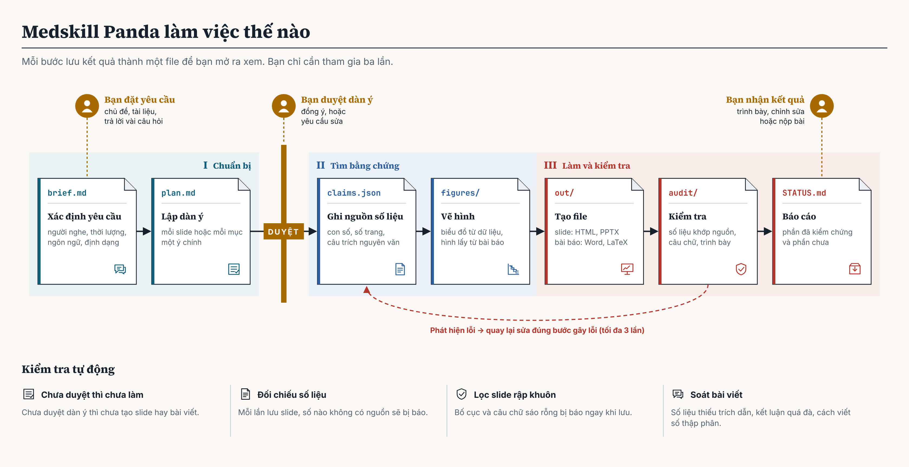
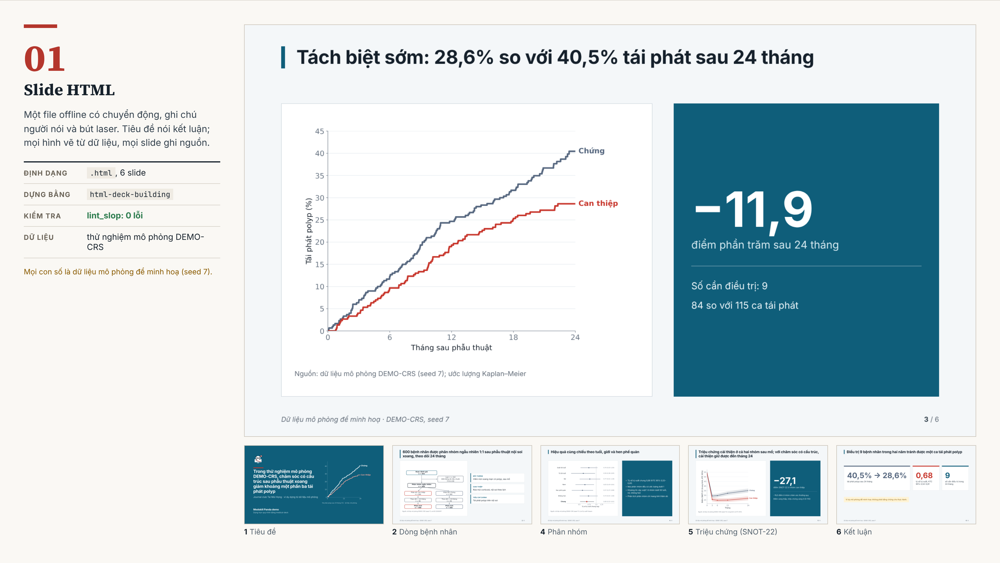
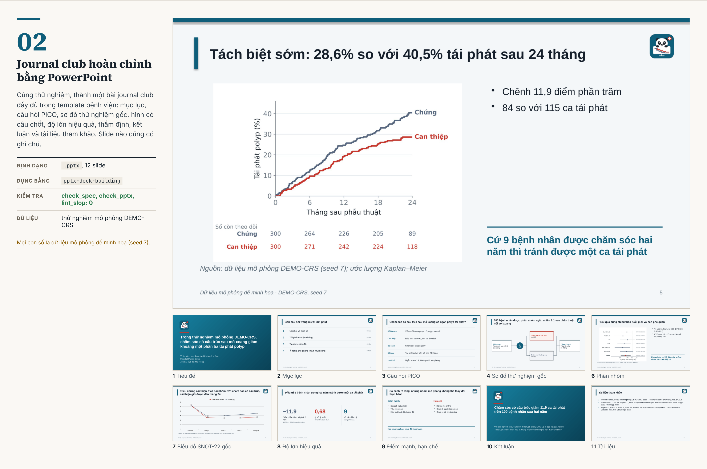
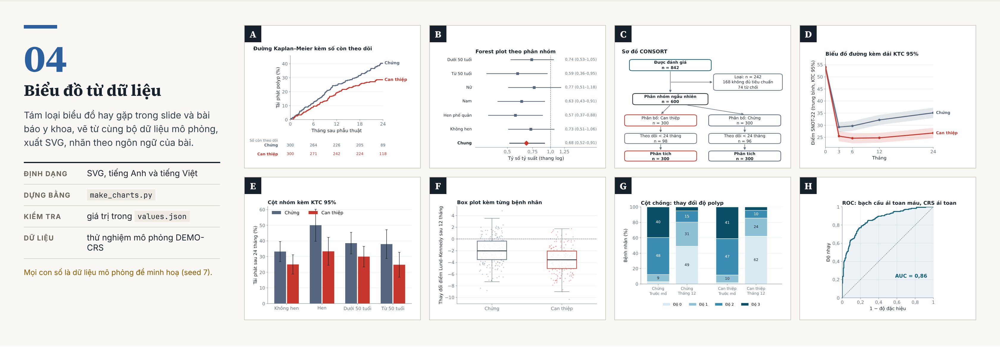
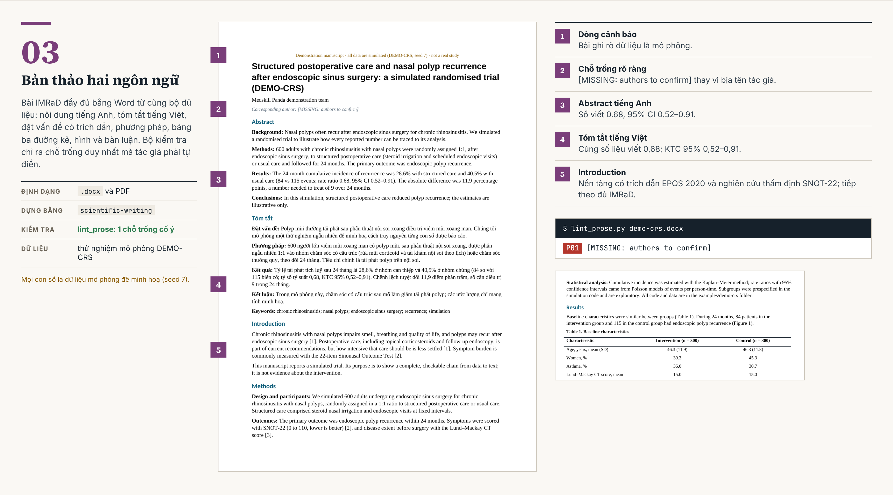

# Hướng dẫn sử dụng Medskill Panda từ A đến Z

[English](GUIDE.md) · **Tiếng Việt**

Hướng dẫn này dành cho người **chưa từng dùng terminal hay Claude Code**. Làm lần lượt từ
trên xuống; mỗi bước có cách kiểm tra đã làm đúng chưa. Lần đầu mất khoảng 20–30 phút.

**Mục lục**

1. [Medskill Panda làm được gì](#1-medskill-panda-làm-được-gì)
2. [Cần chuẩn bị gì](#2-cần-chuẩn-bị-gì)
3. [Mở terminal](#3-mở-terminal)
4. [Cài Claude Code](#4-cài-claude-code)
5. [Tạo thư mục làm việc và đăng nhập](#5-tạo-thư-mục-làm-việc-và-đăng-nhập)
6. [Cài plugin Medskill Panda](#6-cài-plugin-medskill-panda)
7. [Làm bài thuyết trình đầu tiên](#7-làm-bài-thuyết-trình-đầu-tiên)
8. [Kiểm tra một bộ slide có sẵn](#8-kiểm-tra-một-bộ-slide-có-sẵn)
9. [Viết bài báo, luận văn, đề cương](#9-viết-bài-báo-luận-văn-đề-cương)
10. [Làm tiếp vào hôm sau](#10-làm-tiếp-vào-hôm-sau)
11. [Cập nhật plugin](#11-cập-nhật-plugin)
12. [Xử lý sự cố](#12-xử-lý-sự-cố)
13. [Lưu ý về dữ liệu và trách nhiệm](#13-lưu-ý-về-dữ-liệu-và-trách-nhiệm)
14. [Giải thích thuật ngữ](#14-giải-thích-thuật-ngữ)

---

## 1. Medskill Panda làm được gì

Medskill Panda là một **plugin** (gói mở rộng) cho **Claude Code**, trợ lý AI chạy trên máy
tính của bạn. Sau khi cài, bạn chỉ cần gõ yêu cầu bằng tiếng Việt hoặc tiếng Anh, ví dụ
*"Làm slide journal club 15 phút về thử nghiệm SINUS-52"*, và plugin sẽ:

1. hỏi bạn một lượt câu hỏi (đối tượng nghe, thời lượng, ngôn ngữ, định dạng…);
2. lập kế hoạch từng slide và **chờ bạn duyệt**;
3. tra cứu PubMed, ClinicalTrials.gov…, ghi lại nguồn và câu trích cho từng con số;
4. vẽ biểu đồ từ dữ liệu, dựng slide HTML, PowerPoint hoặc PDF;
5. tự kiểm tra: số liệu so với nguồn, dấu hiệu "slide do máy làm", thông tin bệnh nhân;
6. giao file cùng báo cáo: cái gì đã kiểm chứng, cái gì chưa.

Với bài báo, luận văn, đề cương, quy trình tương tự nhưng đầu ra là file Word, LaTeX hoặc
Markdown, bằng tiếng Việt, tiếng Anh hoặc song ngữ.



## 2. Cần chuẩn bị gì

| Thứ cần có | Ghi chú |
|------------|---------|
| Máy tính macOS, Windows 10/11 hoặc Linux | Có kết nối internet |
| Tài khoản Claude **trả phí** (Pro, Max, Team hoặc Enterprise) hoặc tài khoản Claude Console | Claude Code không chạy với tài khoản miễn phí |
| Python 3.8 trở lên | Để các bước tự kiểm tra hoạt động. macOS và Linux thường có sẵn; trên Windows cài từ python.org và **tích "Add python.exe to PATH"** khi cài |
| PowerPoint, Word hoặc LibreOffice | Chỉ để mở file kết quả `.pptx`, `.docx` |

Không cần biết lập trình. Bạn chỉ gõ vài lệnh có sẵn trong hướng dẫn này.

## 3. Mở terminal

Terminal là cửa sổ để gõ lệnh.

- **macOS:** nhấn `Cmd + Space`, gõ `Terminal`, nhấn Enter.
- **Windows:** nhấn phím Windows, gõ `PowerShell`, chọn **Windows PowerShell**.
- **Linux:** nhấn `Ctrl + Alt + T`.

Mỗi khi hướng dẫn có một khung lệnh, hãy **sao chép nguyên khung**, dán vào terminal và nhấn
Enter. Trên Windows, dán bằng chuột phải hoặc `Ctrl + V`.

## 4. Cài Claude Code

Chọn **một** lệnh đúng với máy của bạn.

**macOS hoặc Linux:**

```bash
curl -fsSL https://claude.ai/install.sh | bash
```

**Windows, trong PowerShell:**

```powershell
irm https://claude.ai/install.ps1 | iex
```

**Windows, nếu bạn dùng Command Prompt (CMD) thay vì PowerShell:**

```bat
curl -fsSL https://claude.ai/install.cmd -o install.cmd && install.cmd && del install.cmd
```

**Kiểm tra:** đóng terminal, mở lại, rồi gõ:

```bash
claude --version
```

Nếu thấy một số phiên bản là đã cài xong. Nếu báo *"claude is not recognized"* hoặc
*"command not found"*, xem [Xử lý sự cố](#12-xử-lý-sự-cố).

> Lệnh cài lấy từ tài liệu chính thức của Claude Code:
> [code.claude.com/docs/en/setup](https://code.claude.com/docs/en/setup). Nếu lệnh trên không
> chạy, hãy xem trang đó vì lệnh có thể đã đổi.

## 5. Tạo thư mục làm việc và đăng nhập

Mỗi bài thuyết trình hoặc bài báo nên có một thư mục riêng. Tạo thư mục `bai-noi` trong thư
mục Documents:

**macOS hoặc Linux:**

```bash
mkdir -p ~/Documents/bai-noi && cd ~/Documents/bai-noi
```

**Windows (PowerShell):**

```powershell
mkdir $HOME\Documents\bai-noi; cd $HOME\Documents\bai-noi
```

Khởi động Claude Code trong thư mục đó:

```bash
claude
```

Lần đầu, Claude Code mở trình duyệt để bạn **đăng nhập** tài khoản Claude. Đăng nhập xong,
quay lại terminal. Khi thấy ô nhập có dấu `>` là sẵn sàng.

## 6. Cài plugin Medskill Panda

Trong ô nhập của Claude Code (không phải terminal thường), gõ lần lượt hai lệnh sau, mỗi lệnh
nhấn Enter:

```text
/plugin marketplace add jackfeng94/medskill-panda
```

```text
/plugin install medskill-panda@medskill-panda
```

Làm theo lời nhắc trên màn hình nếu có. Sau đó **thoát Claude Code** (gõ `/exit` hoặc nhấn
`Ctrl + C` hai lần) rồi chạy lại `claude` để plugin được nạp.

**Kiểm tra:** gõ `/plugin` và xem `medskill-panda` có trong danh sách đã cài. Hoặc gõ
`/medskill-panda:status`; nếu Claude trả lời rằng chưa có bài nói nào là plugin đã chạy.

## 7. Làm bài thuyết trình đầu tiên

### 7.1. Chuẩn bị tài liệu (không bắt buộc)

Nếu bạn có bài báo PDF, guideline hoặc template PowerPoint của bệnh viện, hãy chép chúng vào
thư mục `bai-noi` trước. Plugin sẽ dùng chúng làm nguồn chính và tìm thêm nếu thiếu.

### 7.2. Gõ yêu cầu

Trong Claude Code, gõ yêu cầu bằng lời thường. Ví dụ:

```text
Làm slide journal club 15 phút về bài báo SINUS-52 trong file sinus-52.pdf, cho bác sĩ nội trú
```

### 7.3. Trả lời câu hỏi

Lượt đầu, plugin **chỉ hỏi chứ chưa làm gì**. Bạn nhận khoảng 6–8 câu hỏi đánh số, mỗi câu
có đáp án gợi ý. Bạn có thể trả lời ngắn:

```text
1 đồng ý; 2 15 phút + 5 phút hỏi đáp; 3 tiếng Việt, giữ thuật ngữ tiếng Anh; 4 PowerPoint;
5 dùng template bv.pptx; 6 người trình bày: BS. Nguyễn Văn A, khoa Tim mạch
```

Plugin tóm tắt thành `brief.md` và hỏi bạn xác nhận. Trả lời *"Đúng"* hoặc sửa chỗ sai.

### 7.4. Duyệt kế hoạch

Plugin viết `plan.md`: tiêu đề từng slide (là một câu kết luận), hình minh hoạ, các con số
cần tìm, thời gian mỗi slide. Mở file này hoặc đọc ngay trên màn hình, rồi:

- đồng ý: gõ *"Duyệt kế hoạch"*;
- muốn sửa: nói rõ, ví dụ *"Gộp slide 4 và 5, thêm một slide về tác dụng phụ"*.

**Trước khi bạn duyệt, plugin không dựng slide nào.** Đây là chủ ý: một bộ phận tự động
(gọi là *hook*) chặn việc ghi vào thư mục `build/` và `out/` cho đến khi kế hoạch được duyệt.

### 7.5. Chờ plugin làm việc

Plugin tra cứu, vẽ hình, dựng slide rồi tự kiểm tra. Việc này mất vài phút đến vài chục phút
tuỳ độ dài. Bạn có thể đọc tiến độ trên màn hình. Nếu Claude Code hỏi xin phép chạy lệnh hoặc
ghi file, đọc và chọn **Yes**.

### 7.6. Mở kết quả

Mọi thứ nằm trong một thư mục con mang tên bài nói, ví dụ `bai-noi/sinus-52/`:

| File | Là gì |
|------|-------|
| `out/<tên>.html` | Bộ slide HTML. Mở bằng Chrome, Edge, Safari hoặc Firefox |
| `out/<tên>.pptx` | Bộ slide PowerPoint (nếu bạn chọn PowerPoint). Mọi chữ, sơ đồ, biểu đồ đều sửa được |
| `audit/` | Báo cáo kiểm tra: số liệu, nguồn, dấu hiệu "slide do máy làm" |
| `brief.md`, `plan.md` | Thông tin bài nói và kế hoạch bạn đã duyệt |
| `evidence/` | Nguồn, câu trích và vị trí trong bài báo của từng con số |
| `STATUS.md` | Tiến độ từng bước |

Mở thư mục nhanh từ terminal: macOS `open .`, Windows `explorer .`.



*Ví dụ bộ slide HTML do plugin dựng từ dữ liệu mô phỏng (thư mục `examples/demo-crs`).*



*Cùng thử nghiệm thành một bài journal club 12 slide hoàn chỉnh bằng PowerPoint trong template: mục lục, câu hỏi PICO, sơ đồ thử nghiệm, hình kèm câu chốt, độ lớn hiệu quả, điểm mạnh và hạn chế, kết luận, tài liệu tham khảo. Sơ đồ và biểu đồ sửa được.*

**Trình chiếu file HTML:**

| Phím | Tác dụng |
|------|----------|
| `→`, `Space`, `Enter` | Slide tiếp / bước tiếp |
| `←` | Slide trước |
| `F` | Toàn màn hình |
| `N` | Ghi chú cho người nói |
| `L` | Bút laser |
| `P` | Bút vẽ; `C` khoanh tròn; `Z` hoàn tác; `E` xoá nét trên slide |
| `Esc` | Về con trỏ thường |
| `1`–`9` | Nhảy đến slide số đó |

### 7.7. Sửa sau khi đã có slide

Cứ nói bằng lời: *"Slide 6 nhiều chữ quá, rút còn 3 ý"*, *"Đổi biểu đồ cột thành forest
plot"*, *"Thêm slide tài liệu tham khảo"*. Plugin sửa đúng bước liên quan và kiểm tra lại.

Các loại biểu đồ plugin vẽ từ dữ liệu, bạn có thể gọi tên khi yêu cầu sửa:



### 7.8. Journal club từ một bài báo (PDF)

Chép file PDF bài báo vào thư mục làm việc rồi gõ, ví dụ:

```text
Làm journal club 15 phút bằng PowerPoint từ trial.pdf, tiếng Việt
```

Sau các câu hỏi thường lệ và khi bạn duyệt kế hoạch, plugin đọc toàn văn PDF, ghi mọi con số kèm
trang và câu trích, lấy hình (đường Kaplan–Meier, forest plot) từ chính PDF, rồi dựng bộ slide
đầy đủ: tiêu đề kèm trích dẫn bài báo, mục lục, câu hỏi dạng PICO, sơ đồ thử nghiệm, kết quả kèm
một câu chốt, độ lớn hiệu quả, điểm mạnh và hạn chế, kết luận, tài liệu tham khảo và slide kết,
có ghi chú người nói trên mọi slide. Trước khi dựng, plugin kiểm tra không thiếu phần nào.

## 8. Kiểm tra một bộ slide có sẵn

Chép file `.pptx` hoặc `.html` vào thư mục làm việc, rồi gõ:

```text
/medskill-panda:audit-deck
```

Plugin hỏi tên file và bài báo gốc (nếu có), rồi báo: số liệu sai hoặc không có nguồn, trích
dẫn không tra được, thông tin định danh bệnh nhân, dấu hiệu "slide do máy làm". Lỗi chặn được
liệt kê trước.

## 9. Viết bài báo, luận văn, đề cương

### 9.1. Thiết lập dự án viết (một lần cho mỗi thư mục)

Tạo thư mục mới, ví dụ `bai-bao`, chạy `claude` trong đó, rồi gõ:

```text
/medskill-panda:scientific-writer-init
```

Lệnh này tạo `CLAUDE.md` và `AGENTS.md`, file hướng dẫn cho Claude về cách viết có kiểm chứng.

### 9.2. Yêu cầu viết

Ví dụ:

```text
Viết bài báo gốc về nghiên cứu cắt ngang tỷ lệ suy yếu ở người cao tuổi nằm viện,
dữ liệu trong data/ket-qua.xlsx, gửi Tạp chí Y học Việt Nam, tóm tắt song ngữ
```

```text
Draft a STROBE-compliant cohort paper in English for an international journal from data/results.csv
```

Giống khi làm slide, plugin hỏi trước (loại bài, nơi gửi, **ngôn ngữ: Việt, Anh hay song
ngữ**, định dạng Word/LaTeX/Markdown, thiết kế nghiên cứu), rồi viết dàn ý và **chờ bạn
duyệt** trước khi viết.

Đặt dữ liệu và bảng kết quả vào thư mục `data/`, bài báo đã có vào `sources/`. Plugin chỉ lấy
số liệu từ đó hoặc từ nguồn đã tra cứu, không tự nghĩ ra số.

### 9.3. Kiểm tra bản thảo

```text
/medskill-panda:audit-manuscript drafts/v2_bai-bao.docx
```

Báo cáo nằm trong `audit/`: cụm từ sáo kiểu AI, câu phóng đại, thống kê thiếu trích dẫn,
`p = 0.000`, dấu thập phân lẫn lộn, số liệu lệch giữa bản tiếng Việt và tiếng Anh. Plugin
không tự sửa bản thảo; nó đề xuất và chỉ sửa những gì bạn đồng ý, lưu thành phiên bản mới.

Chỗ nào ghi `[MISSING: …]` là thông tin **chỉ bạn mới điền được** (ví dụ số quyết định của hội
đồng đạo đức). Plugin cố ý để lộ, không bịa.



*Bản thảo mẫu: tóm tắt tiếng Anh và tiếng Việt, bảng từ dữ liệu, và chỗ `[MISSING]` mà bộ kiểm tra chỉ ra.*

### 9.4. Từ bài báo ra slide hoặc poster

Khi bài báo đã viết xong, chuyển nó thành slide hoặc poster dùng **cùng số liệu**:

```text
/medskill-panda:paper-to-deck
```

Plugin đọc sổ bằng chứng của bài báo, chỉ hỏi thêm những gì bài nói cần (sự kiện, người nghe,
thời lượng, định dạng), rồi nhập mọi nhận định kèm nguồn và câu trích. Con số nào trên slide không
có trong bài báo sẽ bị báo ngay khi slide được lưu.

## 10. Làm tiếp vào hôm sau

Mở terminal, vào lại đúng thư mục, chạy `claude`:

```bash
cd ~/Documents/bai-noi
```

```bash
claude
```

Rồi gõ:

```text
/medskill-panda:status
```

Plugin đọc `STATUS.md` và cho biết mỗi bài đang ở bước nào, bước tiếp theo là gì. Gõ
*"Làm tiếp bài sinus-52"* để tiếp tục.

## 11. Cập nhật plugin

Trong Claude Code:

```text
/plugin marketplace update medskill-panda
```

Thoát và mở lại `claude`. Với dự án viết đã thiết lập từ trước, chạy lại
`/medskill-panda:scientific-writer-init` và chọn **Back up** để nhận hướng dẫn mới (bản cũ
được giữ thành `CLAUDE.md.bak`).

## 12. Xử lý sự cố

| Hiện tượng | Cách xử lý |
|------------|------------|
| `claude is not recognized` / `command not found` sau khi cài | Đóng **tất cả** cửa sổ terminal rồi mở lại. Trên Windows, nếu vẫn lỗi, khởi động lại máy |
| Lỗi `irm is not recognized` | Bạn đang ở CMD; mở **PowerShell** hoặc dùng lệnh cài cho CMD |
| Lỗi tham số khi dán lệnh `curl … \| bash` trên Windows | Đó là lệnh cho macOS/Linux; dùng lệnh PowerShell |
| Không đăng nhập được | Kiểm tra tài khoản là gói trả phí; thử lại `claude` và đăng nhập trong trình duyệt |
| `/medskill-panda:…` báo không có lệnh | Plugin chưa nạp: thoát `claude` và mở lại; gõ `/plugin` để xem đã cài chưa |
| Plugin báo *"plan gate: build/ and out/ stay closed…"* | Kế hoạch chưa được duyệt. Đọc `plan.md` và gõ *"Duyệt kế hoạch"* |
| Plugin chỉ hỏi mà không làm slide | Đúng thiết kế: lượt đầu luôn là phỏng vấn. Trả lời các câu hỏi là tiếp tục |
| Các bước tự kiểm tra không thấy chạy | Chưa có Python 3.8+. Cài Python (Windows: tích *Add to PATH*), mở lại terminal |
| File `.pptx` mở bị lệch phông | Máy thiếu phông của template; cài phông đó hoặc chọn phông có sẵn khi trả lời câu hỏi |
| Muốn dừng giữa chừng | Nhấn `Esc` để ngắt lượt đang chạy; công việc đã ghi file không mất |

Vẫn không được: mở một *issue* tại
[github.com/jackfeng94/medskill-panda/issues](https://github.com/jackfeng94/medskill-panda/issues),
mô tả việc bạn làm và dán thông báo lỗi.

## 13. Lưu ý về dữ liệu và trách nhiệm

- **Không đưa thông tin định danh bệnh nhân** (họ tên, số hồ sơ, ngày sinh, ảnh khuôn mặt) vào
  thư mục làm việc. Plugin có bước quét, nhưng bước quét không thay được việc khử định danh.
- **Bạn chịu trách nhiệm cuối cùng** về nội dung trình bày và bài báo. Đọc báo cáo kiểm tra,
  nhất là phần "chưa kiểm chứng", trước khi trình bày hoặc nộp.
- Bản thảo chưa công bố được xử lý trên máy bạn; plugin không gửi nội dung đó cho dịch vụ
  tìm kiếm bên ngoài nếu bạn chưa cho phép. Chỉ từ khoá tìm kiếm được gửi đi.
- Các skill lâm sàng (báo cáo ca, phác đồ) chỉ dùng cho tài liệu nghiên cứu hoặc đã khử định
  danh, không dùng để ra quyết định điều trị.

## 14. Giải thích thuật ngữ

| Thuật ngữ | Nghĩa |
|-----------|-------|
| Terminal | Cửa sổ gõ lệnh (Terminal trên macOS, PowerShell trên Windows) |
| Thư mục làm việc | Thư mục bạn đang đứng khi chạy `claude`; mọi file được tạo trong đó |
| Claude Code | Trợ lý AI của Anthropic chạy trong terminal, đọc và ghi file trên máy bạn |
| Plugin | Gói mở rộng cài thêm vào Claude Code; Medskill Panda là một plugin |
| Skill | Một bộ hướng dẫn chuyên biệt trong plugin, ví dụ `medical-deck`, `scientific-writing` |
| Lệnh `/…` | Lệnh gõ trong Claude Code, bắt đầu bằng dấu `/` |
| Hook | Bộ phận chạy tự động, ví dụ chặn dựng slide khi kế hoạch chưa duyệt |
| Brief | Tóm tắt yêu cầu bài nói sau phỏng vấn (`brief.md`) |
| Plan / dàn ý | Kế hoạch từng slide hoặc từng phần bài báo, bạn duyệt trước khi dựng |
| Sổ bằng chứng | Danh sách con số và nhận định kèm nguồn, vị trí và câu trích |
| Slop | Dấu hiệu nội dung do máy làm: nhãn thừa, cụm từ sáo, chỉ dẫn "bấm tiếp" trên slide… |
| Markdown (`.md`) | Định dạng văn bản đơn giản, mở được bằng mọi trình soạn thảo |
